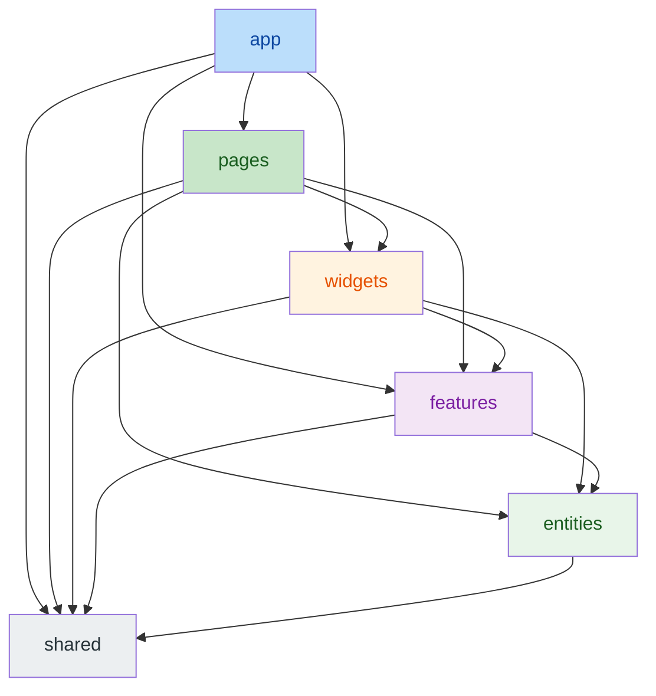
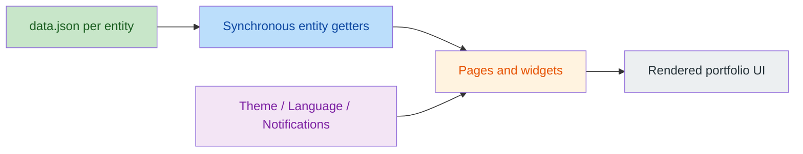

# 🏗️ Architecture Guide

🇺🇸 **English** | [🇪🇸 Español](docs/es/ARCHITECTURE.md)

This document provides a detailed analysis of the architectural patterns and technology decisions for the Portfolio project. For deployment, infrastructure, and environment configuration, see the [Operations Guide](OPERATIONS.md).

---

## 🏗️ Architecture & Principles

The project is a **fully static frontend application**. There is no backend, no database, and no server runtime — only static assets served by a CDN.

### ⚛️ Frontend Architecture
- **Feature-Sliced Design (FSD):** Codebase organized into 6 canonical layers — `app/`, `pages/`, `widgets/`, `features/`, `entities/`, `shared/` — with the import and placement rules of [Feature-Sliced Design Rules](#-feature-sliced-design-rules), enforced by ESLint and proved by `frontend/eslint.config.test.ts`.
- **Static Content Model:** All business content (profile, projects, skills, experiences, spoken languages) lives in bilingual JSON files inside each entity's `api/` segment (`frontend/src/entities/<entity>/api/data.json`). Content is read synchronously at runtime and is validated by the test suite.
- **State Management:** React Context API for cross-cutting UI state: theme, language and notifications. No server state exists. The theme follows the operating system until the visitor picks one; only explicit choices are saved, through a storage helper that keeps the page working when the browser blocks site data.
- **Dynamic Localization:** Centralized i18next system for real-time interface translation; content fields are bilingual En/Es pairs in the JSON data. The language comes from a `?lang=es|en` link, then the visitor's saved choice, then the browser; the URLs and their SEO metadata stay English (no `/es/` routes), so search engines index the English version only. Dates and percentages are formatted per language by the same helpers in the pages and the markdown twins (`Mar 2025 – Jun 2025`, `mar 2025 – jun 2025`, `80 %` in Spanish).
- **Single route list:** `APP_ROUTES` (`frontend/src/shared/config/routes.ts`) feeds the router, both navigation menus and the build-time HTML shells, so a page cannot exist without its shell. Any other address is a real 404 (see below).

### 🖼️ Asset Strategy
- Content images are **self-hosted** under `frontend/public/images/`: one folder per project slug, the profile photo in `profile/` and the generic `no-image.svg` fallback. The profile fallback (`profile-fallback.webp`) and the social preview (`og-cover-typographic.jpg`) sit at `frontend/public/`, and the GONZALO.DEV icons (SVG, ICO and apple-touch PNG) in `frontend/public/icons/`.
- Every project image ships in three WebP widths (`-thumb` 160 px, `-800`, `-full`) and records its full width and English/Spanish alt texts in the data. Covers are composed at exactly 16:9, the ratio the cards reserve, so they are never cropped and nothing shifts while they load.
- The Inter font is bundled (`@fontsource-variable/inter`) and its latin file is preloaded by the build.
- External image and font hosts are forbidden: the data-integrity tests reject external image URLs and the Content-Security-Policy would block them.

### 📬 Contact
- The contact form runs entirely in the browser via **EmailJS**; there is no server-side mail handling. The SDK is loaded only when a message is sent, and one 15-second deadline covers both loading it and waiting for the send. A late SDK load never starts a send after that deadline; if sending has already started, the message may still arrive, so the visitor is asked to email instead of resending. Fields are validated in the visitor's language and remain read-only while sending, preserving focus and preventing edits from being erased by a successful response.

### 🔒 Security
- There is no backend and no authentication surface. Vercel sends a strict Content-Security-Policy on every response (scripts only from the site plus the inline theme script by its hash, network requests only to the site itself and EmailJS) and the usual hardening headers; see the [Operations Guide](OPERATIONS.md).

## 📊 Architecture at a Glance

### FSD layer flow

### Static content flow

### Agent-readable output

The same entity data feeds a build-time generator (`frontend/tooling/agent-files/`, wired into `frontend/vite.config.ts`) that emits, with nothing generated committed to git:

- `llms.txt`, `robots.txt` and `sitemap.xml` at the site root.
- Markdown twins (`/about/index.md`, `/about/index.es.md`, ...) in English and Spanish for every route, linked from the HTML with `<link rel="alternate" type="text/markdown" hreflang="en|es">`. Each twin ends with links to the other pages, and they are served with `X-Robots-Tag: noindex`, so search engines index the HTML pages instead.
- One HTML shell per route, the home page included, with its own title, description, Open Graph title/description/URL, canonical address, markdown alternates and structured data: one JSON-LD `@graph` with `WebSite` and `Person` (name, job title, core competencies, spoken languages and profiles, all derived from the content). Crawlers and link previews get the right metadata without running JavaScript; the page content itself reaches readers without JavaScript through the markdown twins, which the shell's `<noscript>` text links. After a client-side navigation the SPA points the canonical link and the alternates at the new page.
- `404.html` (`noindex`, no canonical), which Vercel serves with status 404 for any other address; with JavaScript, the app on that page sends the visitor home.

`pnpm dev` serves `llms.txt`, `robots.txt`, `sitemap.xml` and the markdown twins through middleware; the per-route HTML shells, their head block (canonical, alternates, JSON-LD) and `404.html` are only produced by `pnpm build` (check them with `pnpm preview` at the trailing-slash address, e.g. `/about/`). `pnpm build` emits everything into `dist/`. Unit tests pin content, metadata parity with i18n and that every internal link resolves to a generated file.

---

## 🧱 Feature-Sliced Design Rules

This section governs the shape of the code in `src`: where each thing goes, what may import what and how the code reaches the network. How agents work in the repository is in `AGENTS.md` and `frontend/AGENTS.md`; the project's own conventions (content, images, i18n, theming, accessibility) are in the `portfolio-conventions` skill. Paths in this section are relative to `frontend/`.

**Each rule says what enforces it.** A rule the lint enforces has, in `eslint.config.test.ts`, the smallest file that breaks it, and that test fails if someone relaxes the rule in `eslint.config.js`. The fsd-lint 1.2.1 rules do not read re-exports (`export … from`), and `fsd/forbidden-imports` does not read a dynamic `import()` either: over them, a local rule, `fsd-gaps/boundaries` (`eslint-fsd-gaps.js`), holds the same boundaries, and it goes away when fsd-lint reads them. No comment switches a rule off: the lint reports an `eslint-disable` comment as a warning, and `pnpm lint` fails on any warning, so an exception lives in `eslint.config.js`, next to its decision. A rule marked *convention* is checked by nothing: the review of the diff holds it, and it becomes a lint rule with its case as soon as someone finds how.

### Layers

`src` holds these six folders and nothing else, from top to bottom:

| Layer | What it holds |
|---|---|
| `app` | The entry point (`src/app/main.tsx`) and Vite's ambient declarations (`src/app/vite-env.d.ts`), the providers, the router, the public layout and the global styles |
| `pages` | A whole screen: it composes what is below and keeps the code only it uses |
| `widgets` | A large UI block that pages or the public layout of `app` use (`navbar`, `footer`) |
| `features` | A user action with value of its own (`contact-form`, `language-switch`, `theme-switch`, `notifications`) |
| `entities` | A business concept: its types, its rules, its static content and its view (`profile`, `project`, `skill`, `experience`, `spoken-language`) |
| `shared` | What knows nothing of the business: configuration, utilities, the base UI |

- **A layer imports only from the layers below it.** Enforced by `fsd/forbidden-imports` and, in a re-export or a dynamic `import()`, by `fsd-gaps/boundaries`.
- **Two slices of the same layer do not import each other.** If both need something, that something moves down to a lower layer. Enforced by `fsd/no-cross-slice-dependency` and, in a re-export, by `fsd-gaps/boundaries`.
- **There are no other layers.** A code file outside those six folders, or loose at the root of `src`, is a `no-restricted-syntax` error; folders such as `services`, `hooks` or `utils` at the root do not exist.
- **Code in `src` is TypeScript in `.ts` and `.tsx` files**, the only files these rules read: a `.js`, `.jsx`, `.mjs`, `.cjs`, `.mts` or `.cts` file is a `no-restricted-syntax` error, or a parsing error when it holds TypeScript or JSX syntax.
- `app` and `shared` have no slices, by convention: their inner folders are segments (`app/providers`, `app/routing`, `app/layouts`, `app/styles`; `shared/config`, `shared/lib`, `shared/ui`). `app/layouts` splits its view (`ui`) from its hooks (`lib`), and that `lib` keeps the rules of the logic segments below.
- **Build-time code is outside the layers (decision).** `tooling/` (the agent-file generator, the font preload and the hosting tests) reads the content and the helpers of `src` directly to publish them, and the configuration at the root (`vite.config.ts`, which loads that tooling, `vitest.config.ts` and `eslint.config.test.ts`) is not application code, so the Feature-Sliced Design rules apply to `src` only. The test rules below apply to every test, `tooling/` included.

### Slices and segments

A slice is a folder inside `pages`, `widgets`, `features` or `entities` (`src/entities/<slice>/`), named in kebab-case. Inside it, only the segments that hold something:

| Segment | What it holds |
|---|---|
| `ui` | `.tsx` components and the styles they need |
| `model` | Types, business rules as pure functions, hooks, contexts and state |
| `api` | The slice's data access: its static content (`data.json`) and the synchronous getters that read it, or the call to an external SDK |
| `lib` | The slice's internal utilities |
| `config` | The slice's constants |

- **From outside, a slice is entered only through its `<slice>/index.ts`**, which exports on purpose what is public and nothing else: neither an internal file nor a segment (`@/entities/<slice>`, never `@/entities/<slice>/model`). Enforced by `fsd/no-public-api-sidestep`, pages included, and, in a re-export, by `fsd-gaps/boundaries`. `shared` is entered by segment (`@/shared/config`, `@/shared/lib`, `@/shared/ui`), by convention.
- **Between slices, imports use the `@/` alias**, enforced by `fsd/no-relative-imports` and, in a re-export, by `fsd-gaps/boundaries`. **Inside a slice, and inside `app` or a segment of `shared`, they use relative paths**, by convention: entering one's own slice through the alias, and even more through its `<slice>/index.ts`, creates an import cycle the lint does not see. `@/` points at `src/` and is declared once, in `tsconfig.app.json`: Vite and Vitest read it from there (`resolve.tsconfigPaths`), and so does `eslint.config.js`.
- **There is no UI in `model`, `api` and `lib`**: no `.tsx` files and no import, static or dynamic, of a `ui` segment, of styles, of any entry of `react-dom`, of the JSX runtimes or of MUI and Emotion as a whole (`@mui/*`, `@emotion/*`, types included: a type the view needs is declared by the logic, as `NotificationSeverity` in `src/shared/lib`); no `createElement`, `cloneElement` or React as a whole (default, namespace or dynamic import): from React, a logic segment imports by name what is logic, such as its hooks. Enforced by `no-restricted-imports` and `no-restricted-syntax` on those segments; an `api` segment still imports its `data.json` and loads an SDK on demand. That a component does not reach a `model` through another slice's public API is convention: the lint sees paths, not what each one exports. Their tests may render.
- **Tests sit next to what they test**, as `<file>.test.ts` or `<file>.test.tsx`, by convention. The Feature-Sliced Design import rules do not apply to them: a test may enter the slice it tests.
- **Every test runs.** `.skip`, `.todo`, `skipIf` and `runIf` are `no-restricted-properties` errors in every test, those of `tooling/` included; Vitest rejects a committed `.only` (`allowOnly: false`) and fails a test that asserts nothing (`expect.requireAssertions`), both in `vitest.config.ts`.

### Where new code goes

First, in the page that uses it. It moves down when a second consumer appears, and not before: to `widgets` if it is a UI block, to `features` if it is a user action, to `entities` if it is a business concept, and to `shared` if it knows nothing of the business. Moving code down is a change with its own diff, which leaves the imports going through the new place's `<slice>/index.ts`. This is convention; the lint only stops a layer from using what is above it.

### Styles

- Components style themselves with MUI's `sx` prop and the theme (`createAppTheme` in `src/shared/config/theme.ts`); a stylesheet a component needs lives next to it, in its `ui` segment. That neither MUI, Emotion nor a stylesheet is imported from `model`, `api` or `lib` is enforced by the lint; the rest is convention.
- The application-wide stylesheet (`src/app/styles/index.css`: root variables, scroll padding, the skip and return-to-top links, the static ambient glass background and print) is imported by the entry point and nobody else, by convention. The glass background uses radial gradients fixed within the viewport.

### Data and network

- **The flow goes one way:** the view (`ui`) uses the model (`model`) and the content the slice exposes, and the content comes from the `api` segment. That a view does not jump to its slice's `api` is convention.
- **`src` sends no request of its own (decision).** `fetch`, `XMLHttpRequest`, `window.fetch`, `globalThis.fetch` and `self.fetch` are `no-restricted-globals` and `no-restricted-properties` errors anywhere in `src`, tests aside: the site is static and has no HTTP client to exempt. The only network call is the EmailJS SDK, loaded on submit by `src/features/contact-form/api/contactApi.ts` and bounded by a timeout (see [Contact](#-contact)); a new network call is an owner decision, and the Content-Security-Policy's `connect-src` allows only the site's own origin and `https://api.emailjs.com`. That the SDK is loaded only from that `api` segment is convention.
- **Business rules are pure functions**, with their test in the same change: in `model` or `lib` (`validateContactMessage`, `splitDescription`), or in the getters of an `api` segment when they select the slice's own content (`getCoreSkills`); a hook or a provider that keeps state calls them instead of repeating them (`useContactForm`). Convention.

### Naming

By convention: components in PascalCase (`<slice>/ui/ProjectCard.tsx`), hooks in camelCase with `use` in front (`<slice>/model/useContactForm.ts`), slices in kebab-case (`<layer>/contact-form`) and segments in lowercase.

---

## 📐 Content Model

Every record has an `id` (projects use it as their slug and image folder). † marks an En/Es pair (`titleEn`/`titleEs`); the other fields hold one value for both languages.

| Entity | JSON location (under `frontend/src/`) | Key fields |
|---|---|---|
| Profile | `entities/profile/api/data.json` | greeting†, subtitle†, description†, about*† (title, intro title, summary, philosophy), sentence†, fullName†, location†; alternateName (full legal name, JSON-LD only), email, githubUrl, linkedinUrl, cvUrl, logoText, imageUrl |
| Project | `entities/project/api/data.json` | title†, description†, technologies (names, shown untranslated), images (ordered `base`, `fullWidth`, `altEn`/`altEs`; the first is the cover), links (ordered `kind` + `url`; kinds registered in `entities/project/model/projectLinks.ts`), type (`WEB`/`DESKTOP`/`MOBILE`/`OTHER`), featured, order |
| Skill | `entities/skill/api/data.json` | name†, level (0-100), category (one of `SKILL_CATEGORY_ORDER`, translated through i18n), order |
| Experience | `entities/experience/api/data.json` | company†, position†, startDate, endDate (omitted for the current role), description†, technologies |
| SpokenLanguage | `entities/spoken-language/api/data.json` | name†, level†, order |

**Integrity rules** (enforced by `data.test.ts` per entity):
- Every referenced image must be a local path that exists under `frontend/public/images/`. Each project image ships its `-thumb`, `-800` and `-full` variants at the widths `fullWidth` implies (never upscaled), every cover is exactly 16:9, every image has alt texts in both languages (different, at most 250 characters), and no project image ships unused.
- Project links use a registered kind and an `https` address, with no address repeated within a project.
- Technologies are listed once per project or experience; skill categories come from `SKILL_CATEGORY_ORDER`.
- Collections must be ordered (projects/skills/languages by `order` asc; experiences by `endDate DESC NULLS FIRST, startDate DESC`).
- Field contract must hold (types, non-empty text on both sides of every En/Es pair, valid ranges, `YYYY-MM-DD` dates, `https` profile links).

---

## 🚫 Legal Notice

**© 2026 Gonzalo Martínez García. All rights reserved.**

This software is **proprietary** and is provided for **evaluation purposes only**.
- **Unauthorized copying**, modification, distribution, or use of this software, via any medium, is strictly prohibited.
- **Personal use for other portfolios is not allowed.**
- See the [LICENSE](LICENSE) file for full terms and conditions.

---

**Developed by Gonzalo Martínez García**
*Junior Full Stack Developer | Software Engineering & Innovation*
