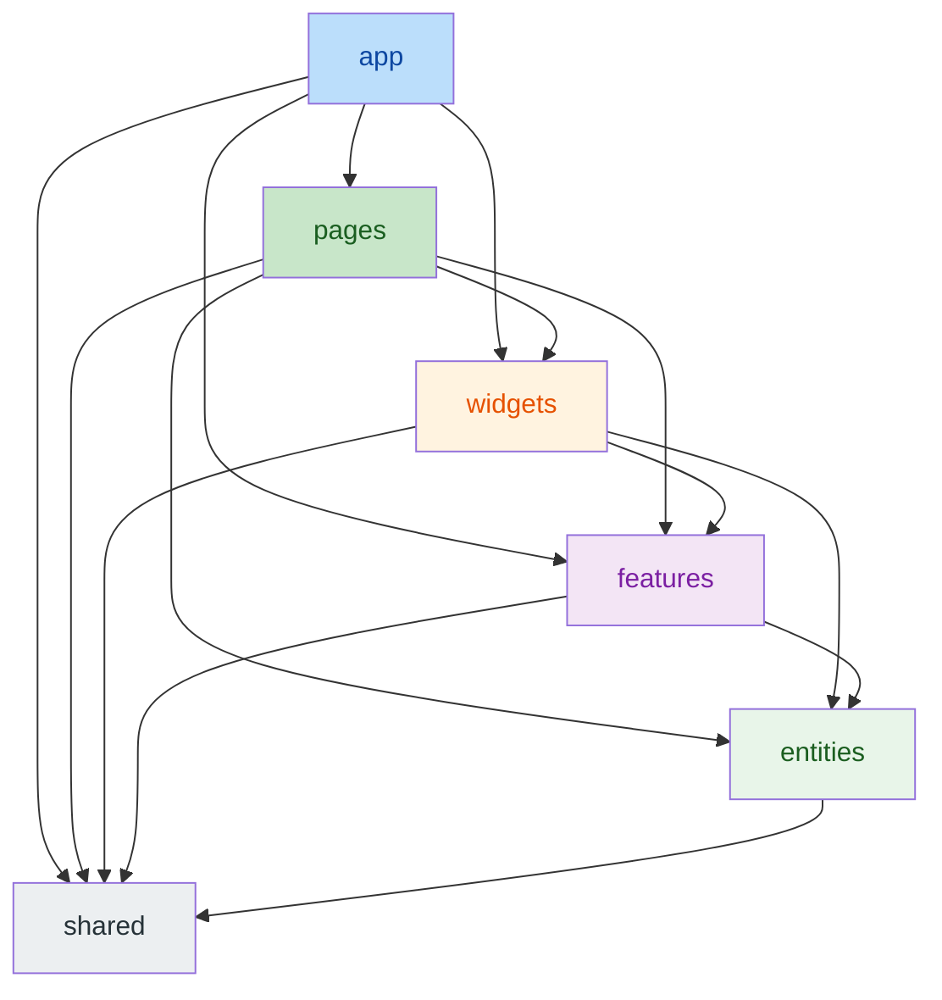
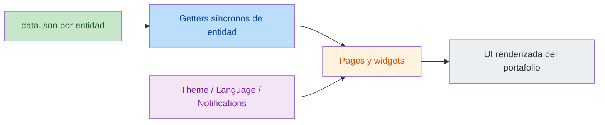

# 🏗️ Guía de arquitectura

🇺🇸 [English](../../ARCHITECTURE.md) | **🇪🇸 Español**

Este documento ofrece un análisis detallado de los patrones arquitectónicos y las decisiones tecnológicas del proyecto Portafolio. Para despliegue, infraestructura y configuración de entorno, consulta la [Guía de operaciones](OPERATIONS.md).

---

## 🏗️ Arquitectura y principios

El proyecto es una **aplicación frontend totalmente estática**. No hay backend, no hay base de datos y no hay runtime de servidor: solo assets estáticos servidos por una CDN.

### ⚛️ Arquitectura del frontend
- **Feature-Sliced Design (FSD):** código organizado en 6 capas canónicas — `app/`, `pages/`, `widgets/`, `features/`, `entities/`, `shared/` — con las reglas de importación y de ubicación de [Reglas de Feature-Sliced Design](#-reglas-de-feature-sliced-design), que hace cumplir ESLint y demuestra `frontend/eslint.config.test.ts`.
- **Modelo de contenido estático:** todo el contenido de negocio (perfil, proyectos, habilidades, experiencias, idiomas hablados) vive en JSON bilingües dentro del segmento `api/` de cada entidad (`frontend/src/entities/<entidad>/api/data.json`). El contenido se lee de forma síncrona en runtime y lo valida la suite de tests.
- **Gestión de estado:** React Context API para el estado de interfaz transversal: tema, idioma y notificaciones. No existe estado de servidor. El tema sigue al sistema operativo hasta que el visitante elige uno; solo se guardan las elecciones explícitas, mediante un helper de almacenamiento que mantiene la página en marcha cuando el navegador bloquea los datos del sitio.
- **Localización dinámica:** sistema centralizado i18next para traducción de la interfaz en tiempo real; los campos de contenido son pares bilingües En/Es en los JSON de datos. El idioma sale de un enlace `?lang=es|en`, después de la elección guardada del visitante y, si no hay, del navegador; las URLs y sus metadatos SEO siguen en inglés (sin rutas `/es/`), así que los buscadores solo indexan la versión en inglés. Las fechas y los porcentajes se formatean según el idioma con los mismos helpers en las páginas y en las copias markdown (`Mar 2025 – Jun 2025`, `mar 2025 – jun 2025`, `80 %` en español).
- **Lista única de rutas:** `APP_ROUTES` (`frontend/src/shared/config/routes.ts`) alimenta el router, los dos menús de navegación y los shells HTML que se generan en build, así que no puede existir una página sin su shell. Cualquier otra dirección es un 404 real (ver más abajo).
- **Indicadores de carga:** el HTML/CSS temporal de `index.html` muestra la marca del portfolio y un indicador indeterminado antes de que se ejecute React. Su primer render sustituye ese contenido; los skeletons de Suspense existentes cubren los módulos de ruta pendientes. La carga, el error y el reintento de imágenes de la galería pertenecen a `entities/project/ui/ProjectGallery.tsx`, independientemente de los datos síncronos de proyectos. No interviene ningún provider, cliente HTTP ni punto de arranque nuevo.

### 🖼️ Estrategia de assets
- Las imágenes de contenido están **autohospedadas** en `frontend/public/images/`: una carpeta por slug de proyecto, la foto de perfil en `profile/` y el fallback genérico `no-image.svg`. El fallback del perfil (`profile-fallback.webp`) y la vista previa social (`og-cover-typographic.jpg`) están en `frontend/public/`, y los iconos GONZALO.DEV (SVG, ICO y PNG apple-touch) en `frontend/public/icons/`.
- Cada imagen de proyecto se publica en tres anchos WebP (`-thumb` de 160 px, `-800` y `-full`) y guarda en los datos su ancho completo y sus textos alternativos en inglés y en español. Las portadas se componen exactamente en 16:9, la proporción que reservan las tarjetas, así que nunca se recortan y nada se desplaza mientras cargan.
- La galería a pantalla completa mantiene una única imagen seleccionada a tamaño completo, con eventos de carga/error del navegador y una comprobación de carga desde caché. El reintento es explícito y se limita a esa imagen; la navegación y el cierre siguen disponibles durante la carga o tras un fallo, y el zoom se habilita solo al cargar correctamente. Estos estados locales del recurso no cambian el modelo de contenido estático ni el listado de proyectos.
- La fuente Inter va en el bundle (`@fontsource-variable/inter`) y el build precarga su fichero latino.
- Los hosts externos de imágenes y fuentes están prohibidos: los tests de integridad de datos rechazan las URLs de imágenes externas y la Content-Security-Policy las bloquearía.

### 📬 Contacto
- El formulario de contacto funciona íntegramente en el navegador mediante **EmailJS**; no hay gestión de correo en servidor. El SDK solo se carga al enviar un mensaje, y un único plazo de 15 segundos cubre tanto su carga como la espera del envío. Una carga tardía del SDK nunca inicia un envío una vez vencido ese plazo; si el envío ya ha empezado, el mensaje puede llegar igualmente, por lo que se pide al visitante que escriba por correo en lugar de reenviar. Los campos se validan en el idioma del visitante y permanecen en solo lectura durante el envío, conservando el foco y evitando que una respuesta exitosa borre cambios posteriores.

### 🔒 Seguridad
- No hay backend ni superficie de autenticación. Vercel envía en cada respuesta una Content-Security-Policy estricta (scripts solo del propio sitio más el script de tema en línea por su hash, peticiones de red solo al propio sitio y a EmailJS) y las cabeceras de endurecimiento habituales; ver la [Guía de operaciones](OPERATIONS.md).

## 📊 Arquitectura de un vistazo

### Flujo de capas FSD

### Flujo de contenido estático

### Salida para agentes

El mismo contenido de las entidades alimenta un generador en build (`frontend/tooling/agent-files/`, integrado en `frontend/vite.config.ts`) que emite, sin nada generado en git:

- `llms.txt`, `robots.txt` y `sitemap.xml` en la raíz del sitio.
- Copias markdown (`/about/index.md`, `/about/index.es.md`, ...) en inglés y español para cada ruta, enlazadas desde el HTML con `<link rel="alternate" type="text/markdown" hreflang="en|es">`. Cada copia termina con enlaces al resto de páginas y se sirven con `X-Robots-Tag: noindex`, para que los buscadores indexen las páginas HTML.
- Un shell HTML por ruta, incluida la de inicio, con su propio title, description, título/descripción/URL de Open Graph, canonical, alternates markdown y datos estructurados: un `@graph` JSON-LD con `WebSite` y `Person` (nombre, puesto, competencias principales, idiomas y perfiles, todo derivado del contenido). Los crawlers y las vistas previas de enlaces reciben los metadatos correctos sin ejecutar JavaScript; el contenido de la página llega a quien no ejecuta JavaScript a través de las copias markdown, que enlaza el texto `<noscript>` del shell. Tras una navegación en el cliente, la SPA apunta el canonical y los alternates a la página nueva.
- `404.html` (`noindex`, sin canonical), que Vercel sirve con estado 404 para cualquier otra dirección; con JavaScript, la app de esa página lleva al visitante al inicio.

`pnpm dev` sirve `llms.txt`, `robots.txt`, `sitemap.xml` y las copias markdown por middleware; los shells HTML por ruta, su bloque de cabecera (canonical, alternates, JSON-LD) y `404.html` solo los genera `pnpm build` (compruébalos con `pnpm preview` en la dirección con barra final, p. ej. `/about/`). `pnpm build` lo emite todo en `dist/`. Los tests fijan el contenido, la paridad de metadatos con i18n y que todo enlace interno resuelva a un fichero generado.

---

## 🧱 Reglas de Feature-Sliced Design

Esta sección manda sobre la forma del código de `src`: dónde va cada cosa, qué puede importar qué y cómo llega el código a la red. Cómo trabajan los agentes en el repositorio lo dicen `AGENTS.md` y `frontend/AGENTS.md`; las convenciones propias del proyecto (contenido, imágenes, i18n, temas, accesibilidad), la skill `portfolio-conventions`. Las rutas de esta sección son relativas a `frontend/`.

**Cada regla dice qué la hace cumplir.** Las que hace cumplir el lint tienen en `eslint.config.test.ts` el fichero más pequeño que las rompe, y ese test falla si alguien relaja la regla en `eslint.config.js`. Las reglas de fsd-lint 1.2.1 no leen las reexportaciones (`export … from`), y `fsd/forbidden-imports` tampoco lee el `import()` dinámico: en ellos sostiene los mismos límites una regla local, `fsd-gaps/boundaries` (`eslint-fsd-gaps.js`), que sobra cuando fsd-lint los lea. Un comentario no apaga ninguna: el lint da por aviso un comentario `eslint-disable`, y `pnpm lint` falla con cualquier aviso, así que una excepción vive en `eslint.config.js`, junto a su decisión. Las que dicen *convención* no las comprueba nada: las sostiene la revisión del diff, y se convierten en regla de lint con su caso en cuanto alguien encuentra cómo.

### Capas

`src` contiene estas seis carpetas y nada más, de arriba abajo:

| Capa | Qué contiene |
|---|---|
| `app` | La entrada (`src/app/main.tsx`) y las declaraciones ambientales de Vite (`src/app/vite-env.d.ts`), los providers, el router, el layout público y los estilos globales |
| `pages` | Una pantalla entera: compone lo de debajo y guarda el código que solo usa ella |
| `widgets` | Un bloque de interfaz grande que usan las páginas o el layout público de `app` (`navbar`, `footer`) |
| `features` | Una acción del usuario con valor propio (`contact-form`, `language-switch`, `theme-switch`, `notifications`) |
| `entities` | Un concepto del negocio: sus tipos, sus reglas, su contenido estático y su vista (`profile`, `project`, `skill`, `experience`, `spoken-language`) |
| `shared` | Lo que no sabe nada del negocio: la configuración, utilidades, la UI base |

- **Una capa solo importa de las que tiene debajo.** Lo hacen cumplir `fsd/forbidden-imports` y, en una reexportación o un `import()` dinámico, `fsd-gaps/boundaries`.
- **Dos slices de la misma capa no se importan entre sí.** Si los dos necesitan algo, ese algo baja a una capa inferior. Lo hacen cumplir `fsd/no-cross-slice-dependency` y, en una reexportación, `fsd-gaps/boundaries`.
- **No hay más capas.** Un fichero de código fuera de esas seis carpetas, o suelto en la raíz de `src`, es un error de `no-restricted-syntax`; carpetas como `services`, `hooks` o `utils` en la raíz no existen.
- **En `src` el código es TypeScript en `.ts` y `.tsx`**, los únicos ficheros que leen estas reglas: un `.js`, `.jsx`, `.mjs`, `.cjs`, `.mts` o `.cts` es un error de `no-restricted-syntax`, o un error de parseo si contiene sintaxis de TypeScript o JSX.
- `app` y `shared` no tienen slices, por convención: sus carpetas internas son segmentos (`app/providers`, `app/routing`, `app/layouts`, `app/styles`; `shared/config`, `shared/lib`, `shared/ui`). `app/layouts` separa su vista (`ui`) de sus hooks (`lib`), y ese `lib` sigue las reglas de los segmentos de lógica de más abajo.
- **El código de build queda fuera de las capas (decisión).** `tooling/` (el generador de ficheros para agentes, la precarga de la fuente y los tests del hosting) lee directamente el contenido y los helpers de `src` para publicarlos, y la configuración de la raíz (`vite.config.ts`, que carga ese tooling, `vitest.config.ts` y `eslint.config.test.ts`) no es código de la aplicación, así que las reglas de Feature-Sliced Design solo se aplican a `src`. Las reglas de tests de más abajo se aplican a todos los tests, los de `tooling/` incluidos.

### Slices y segmentos

Un slice es una carpeta dentro de `pages`, `widgets`, `features` o `entities` (`src/entities/<slice>/`), con nombre en kebab-case. Dentro, solo los segmentos que tengan algo:

| Segmento | Qué contiene |
|---|---|
| `ui` | Componentes `.tsx` y los estilos que necesitan |
| `model` | Tipos, reglas de negocio como funciones puras, hooks, contextos y estado |
| `api` | El acceso a datos del slice: su contenido estático (`data.json`) y los getters síncronos que lo leen, o la llamada a un SDK externo |
| `lib` | Utilidades internas del slice |
| `config` | Constantes del slice |

- **Desde fuera, a un slice solo se entra por su `<slice>/index.ts`**, que exporta a propósito lo que es público y nada más: ni un fichero interno ni un segmento (`@/entities/<slice>`, nunca `@/entities/<slice>/model`). Lo hacen cumplir `fsd/no-public-api-sidestep`, páginas incluidas, y, en una reexportación, `fsd-gaps/boundaries`. A `shared` se entra por segmento (`@/shared/config`, `@/shared/lib`, `@/shared/ui`), por convención.
- **Entre slices se importa con el alias `@/`**, y lo hacen cumplir `fsd/no-relative-imports` y, en una reexportación, `fsd-gaps/boundaries`. **Dentro de un slice, y dentro de `app` o de un segmento de `shared`, con rutas relativas**, por convención: entrar en el propio slice por el alias, y más aún por su `<slice>/index.ts`, crea un ciclo de imports que el lint no ve. `@/` apunta a `src/` y se declara una sola vez, en `tsconfig.app.json`: Vite y Vitest lo leen de ahí (`resolve.tsconfigPaths`), y `eslint.config.js` también.
- **En `model`, `api` y `lib` no hay UI**: ni ficheros `.tsx`, ni imports, estáticos o dinámicos, de un segmento `ui`, de estilos, de cualquier entrada de `react-dom`, de los runtimes de JSX o de MUI y Emotion enteros (`@mui/*`, `@emotion/*`, tipos incluidos: un tipo que necesite la vista lo declara la lógica, como `NotificationSeverity` en `src/shared/lib`); ni `createElement`, `cloneElement` o React entero (por defecto, como espacio de nombres o dinámico): de React, un segmento de lógica importa por nombre lo que es lógica, como sus hooks. Lo hacen cumplir `no-restricted-imports` y `no-restricted-syntax` sobre esos segmentos; un segmento `api` sigue importando su `data.json` y cargando un SDK bajo demanda. Que no llegue un componente a un `model` por la API pública de otro slice es convención: el lint ve rutas, no qué exporta cada una. Sus tests sí pueden renderizar.
- **Los tests van al lado de lo que prueban**, como `<fichero>.test.ts` o `<fichero>.test.tsx`, por convención. Las reglas de imports de Feature-Sliced Design no se les aplican: un test puede entrar en el slice que prueba.
- **Todo test corre.** `.skip`, `.todo`, `skipIf` y `runIf` son errores de `no-restricted-properties` en todos los tests, los de `tooling/` incluidos; Vitest rechaza un `.only` commiteado (`allowOnly: false`) y hace fallar un test que no comprueba nada (`expect.requireAssertions`), los dos en `vitest.config.ts`.

### Dónde va el código nuevo

Primero, en la página que lo usa. Baja cuando aparece el segundo consumidor, y no antes: a `widgets` si es un bloque de interfaz, a `features` si es una acción del usuario, a `entities` si es un concepto del negocio, y a `shared` si no sabe nada del negocio. Bajar código es un cambio con su propio diff, que deja los imports por la `<slice>/index.ts` del nuevo sitio. Es convención; el lint solo impide que una capa use lo que tiene encima.

### Estilos

- Los componentes se estilan con la prop `sx` de MUI y el tema (`createAppTheme` en `src/shared/config/theme.ts`); una hoja de estilos que necesite un componente va a su lado, en su segmento `ui`. Que no se importen MUI, Emotion ni hojas de estilos desde `model`, `api` ni `lib` lo hace cumplir el lint; el resto es convención.
- La hoja de estilos de toda la aplicación (`src/app/styles/index.css`: variables raíz, el margen de scroll, los enlaces de salto y de vuelta arriba, el fondo ambiental estático de cristal y la impresión) la importa la entrada y nadie más, por convención. El fondo de cristal usa degradados radiales fijos dentro del viewport.
- Los estilos temporales de arranque van incrustados en `index.html`, limitados a `.app-startup`, para que el indicador no dependa de la hoja de estilos de la aplicación. Usan el esquema de color del prepaint y respetan el movimiento reducido; no estilan la aplicación React ya montada.

### Datos y red

- **El flujo va en una dirección:** la vista (`ui`) usa el modelo (`model`) y el contenido que expone el slice, y el contenido sale del segmento `api`. Que la vista no salte al `api` de su slice es convención.
- **`src` no envía peticiones propias (decisión).** `fetch`, `XMLHttpRequest`, `window.fetch`, `globalThis.fetch` y `self.fetch` son errores de `no-restricted-globals` y `no-restricted-properties` en cualquier parte de `src`, salvo los tests: el sitio es estático y no tiene cliente HTTP que eximir. La única llamada de red es la del SDK de EmailJS: `src/features/contact-form/api/contactApi.ts` lo carga al enviar un mensaje y acota el envío con un tiempo límite (ver [Contacto](#-contacto)); una llamada de red nueva es una decisión del dueño, y el `connect-src` de la Content-Security-Policy solo admite el propio origen del sitio y `https://api.emailjs.com`. Que el SDK solo se cargue desde ese segmento `api` es convención.
- **Las reglas de negocio son funciones puras**, con su test en el mismo cambio: en `model` o `lib` (`validateContactMessage`, `splitDescription`), o en los getters de un segmento `api` cuando seleccionan el contenido del propio slice (`getCoreSkills`); un hook o un provider que guarda estado las llama en lugar de repetirlas (`useContactForm`). Convención.

### Nombres

Por convención: componentes en PascalCase (`<slice>/ui/ProjectCard.tsx`), hooks en camelCase con `use` delante (`<slice>/model/useContactForm.ts`), slices en kebab-case (`<capa>/contact-form`) y segmentos en minúsculas.

---

## 📐 Modelo de contenido

Todo registro tiene un `id` (los proyectos lo usan como slug y carpeta de imágenes). † marca un par En/Es (`titleEn`/`titleEs`); el resto de campos guarda un único valor para los dos idiomas.

| Entidad | Ubicación JSON (bajo `frontend/src/`) | Campos clave |
|---|---|---|
| Perfil | `entities/profile/api/data.json` | greeting†, subtitle†, description†, about*† (título, título de introducción, resumen, filosofía), sentence†, fullName†, location†; alternateName (nombre legal completo, solo JSON-LD), email, githubUrl, linkedinUrl, cvUrl, logoText, imageUrl |
| Proyecto | `entities/project/api/data.json` | title†, description†, technologies (nombres, sin traducir), images (en orden: `base`, `fullWidth`, `altEn`/`altEs`; la primera es la portada), links (en orden: `kind` + `url`; tipos registrados en `entities/project/model/projectLinks.ts`), type (`WEB`/`DESKTOP`/`MOBILE`/`OTHER`), featured, order |
| Habilidad | `entities/skill/api/data.json` | name†, level (0-100), category (una de `SKILL_CATEGORY_ORDER`, traducida con i18n), order |
| Experiencia | `entities/experience/api/data.json` | company†, position†, startDate, endDate (se omite en el puesto actual), description†, technologies |
| Idioma | `entities/spoken-language/api/data.json` | name†, level†, order |

**Reglas de integridad** (aplicadas por `data.test.ts` de cada entidad):
- Toda imagen referenciada debe ser una ruta local que exista en `frontend/public/images/`. Cada imagen de proyecto incluye sus variantes `-thumb`, `-800` y `-full` con los anchos que se deducen de `fullWidth` (nunca ampliadas), toda portada mide exactamente 16:9, cada imagen tiene textos alternativos en los dos idiomas (distintos, de 250 caracteres como máximo) y no se publica ninguna imagen de proyecto sin usar.
- Los enlaces de proyecto usan un tipo registrado y una dirección `https`, sin repetir direcciones dentro de un proyecto.
- Cada tecnología aparece una sola vez por proyecto o experiencia; las categorías de habilidad salen de `SKILL_CATEGORY_ORDER`.
- Las colecciones deben estar ordenadas (proyectos/habilidades/idiomas por `order` asc; experiencias por `endDate DESC NULLS FIRST, startDate DESC`).
- El contrato de campos debe cumplirse (tipos, texto no vacío en los dos lados de cada par En/Es, rangos válidos, fechas `YYYY-MM-DD`, enlaces de perfil `https`).

---

## 🚫 Aviso legal

**© 2026 Gonzalo Martínez García. Todos los derechos reservados.**

Este software es **propietario** y se proporciona **únicamente con fines de evaluación**.
- **Queda estrictamente prohibida la copia**, modificación, distribución o uso no autorizado de este software por cualquier medio.
- **No está permitido el uso personal para otros portafolios.**
- Consulta el archivo [LICENSE](../../LICENSE) para los términos y condiciones completos.

---

**Desarrollado por Gonzalo Martínez García**
*Desarrollador Full Stack junior | Ingeniería de software e innovación*
